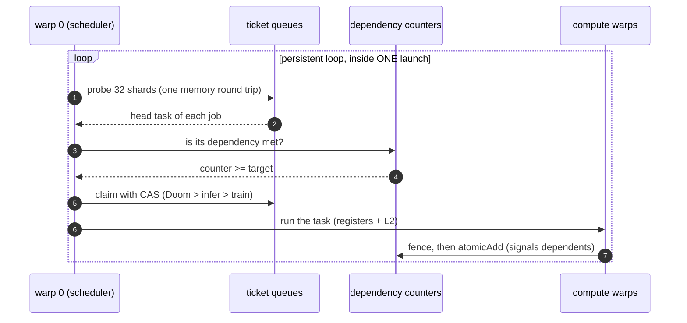
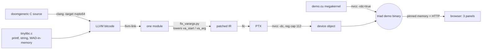

<div align="center">


**🧠 trains &nbsp;·&nbsp; 💬 serves &nbsp;·&nbsp; 👹 plays Doom &nbsp;·&nbsp; all at once, in a single GPU kernel launch**

   

[**📊 Stats site**](site/) &nbsp;·&nbsp; [**🏗️ Architecture**](#️-architecture) &nbsp;·&nbsp; [**🚀 Quickstart**](#-quickstart) &nbsp;·&nbsp; [**📈 Results**](#-results) &nbsp;·&nbsp; [**⚠️ Caveats**](#️-honest-caveats)

</div>

---

**Triad** puts three unrelated programs inside **one persistent GPU kernel** on a single NVIDIA A100 and runs them at the same time:

| | Program | What happens |
|---|---|---|
| 🧠 | **Training** | A character-level language model learns online: forward, backward and SGD all run as tasks inside the kernel. |
| 💬 | **Inference** | Text streams out of the *live, still-training* weights, so the output visibly improves while the loss falls. |
| 👹 | **Doom** | The real engine (doomgeneric, shareware E1M1) runs its own game loop on the GPU, played by a scripted player that fights its way through E1M1 without cheat codes and finishes it after about 43 s of play ([`doom-gpu/player/`](doom-gpu/player/)). |

> 🛰️ **Not affiliated with Flapping Airplanes.** Independent reproduction of an idea from their public demo video. We have not seen their code.

<div align="center">


*The demo is just these three panels. The numbers live on the [stats site](site/).*

</div>

## 🏗️ Architecture

<div align="center">



</div>

**How one kernel runs three programs.** Every block is a long-lived worker. Warp 0 of each block polls sharded ticket queues, claims the next *ready* task (priority Doom > inference > training), and the other warps run it. Tasks signal completion through dependency counters guarded by memory fences, so a forward pass releases its backward pass and a token releases the next token, with no kernel launch in between.



### 👹 One Doom frame

<div align="center">



</div>

Thread 0 runs the game logic and *queues* column and span draws; at two flush points the other 255 threads of the block execute the queue behind a single named barrier. The picture is pixel-identical to serial drawing, but a frame drops from **24 ms to 6.7 ms**.



## 🚀 Quickstart

You need an NVIDIA A100 box (sm_80) reachable over SSH. Run these on your Mac or Linux machine:

```bash
./doom-gpu/setup_box.sh ubuntu@<ip>          # once: clang, doomgeneric, shareware WAD (md5 checked)
./a100-demo/run_demo.sh ubuntu@<ip>          # build, run, tunnel, open http://localhost:8080
./benchmarks/run_benchmarks.sh ubuntu@<ip> 5 6   # 5 reps x 6 s, writes benchmarks/results/
python3 -m http.server 8000 --directory site     # the stats site, http://localhost:8000
```

No A100 box? The same demo and benchmark run on a [Modal](https://modal.com) B200 with no SSH (details in [`benchmarks/README.md`](benchmarks/README.md)):

```bash
uv tool install modal && modal setup                 # once
modal run benchmarks/run_modal.py --mode bench       # builds on CPU, then benchmarks on one B200 (about 7 GPU-minutes)
```

## 📈 Results

NVIDIA A100-SXM4-40GB (108 SMs), 5 repetitions x 6 s, 2026-11-01. Source: [`benchmarks/results/latest.json`](benchmarks/results/latest.json) and [`summary.md`](benchmarks/results/summary.md).

> 🎯 **Triad, all three at once (mean, sd):** **13,507.6** training steps/s (sd 214.1) · 3,457,953 training tok/s · **53,211.6** inference tok/s (sd 751.2) · **35.0** Doom fps (sd 0.0) · **1** kernel launch

The baselines run the *same task code* as ordinary per-op kernels (4 launches per step, 3 per token), each job **alone** unless stated. Doom has no per-op baseline.

| Baseline | Train steps/s | Infer tok/s | Baseline slower than Triad, train / infer | 4,000 steps take |
|---|---|---|---|---|
| Per-op kernels, eager launches | 15,282 | 52,070 | -13.1% / 2.1% | 0.262 s |
| Per-op kernels, CUDA graphs | 16,296 | 60,343 | -20.6% / -13.4% | 0.245 s |
| Both jobs, one process, two CUDA-graph streams | 14,960 | 53,377 | -10.8% / -0.3% | 0.267 s |
| 🥊 Two separate processes sharing the GPU | 7,465 | 27,278 | **44.7% / 48.7%** | 0.536 s |

Negative means the baseline is faster. Triad takes 0.296 s for 4,000 steps.

**The same benchmark on an NVIDIA B200** (148 SMs, on Modal, 5 repetitions x 6 s, 2026-11-01). Source: [`b200_20261101.json`](benchmarks/results/b200_20261101.json) and [`summary_b200.md`](benchmarks/results/summary_b200.md).

> 🟩 **Triad on a B200, all three at once (mean, sd):** **17,788.6** training steps/s (sd 332.7) · 4,553,879 training tok/s · **71,349.9** inference tok/s (sd 382.4) · **35.0** Doom fps (sd 0.0) · **1** kernel launch

| Baseline (B200) | Train steps/s | Infer tok/s | Baseline slower than Triad, train / infer | 4,000 steps take |
|---|---|---|---|---|
| Per-op kernels, eager launches | 22,239 | 68,712 | -25.0% / 3.7% | 0.180 s |
| Per-op kernels, CUDA graphs | 22,111 | 66,873 | -24.3% / 6.3% | 0.181 s |
| Both jobs, one process, two CUDA-graph streams | 21,450 | 64,109 | -20.6% / 10.1% | 0.186 s |
| 🥊 Two separate processes sharing the GPU | 10,328 | 29,961 | **41.9% / 58.0%** | 0.387 s |

Triad takes 0.225 s for 4,000 steps on the B200. Its rates are about 1.3x the A100's, roughly the ratio of the maximum SM clocks (1,965 vs 1,410 MHz); the extra SMs stay idle. The per-op training baseline gained more (1.46x), so its lead grew.

### 🆚 Versus Flapping Airplanes' published numbers

Their column is **read frame by frame from their demo video** ([`benchmarks/fa_published.json`](benchmarks/fa_published.json)); we did not measure it.

**Like-for-like, at LLM scale on one B200** ([`b200-run/`](b200-run/README.md)): the same GPU and 116 / 24 / 8 split, a 162M-parameter GPT with a 100k-token vocabulary, and Megatron + Transformer Engine and vLLM as the baselines, each alone on its SM share.

| | Flapping Airplanes (B200, from video) | Triad, `tcgen05` 3 stages (B200, measured) | Triad, `tcgen05` 2 stages (B200, measured) |
|---|---|---|---|
| Kernel launches for the same work (setup not counted) | 1 vs 514,562 | 1 vs 2.0M-3.9M host launch calls | 1 vs 2.2M-4.2M host launch calls |
| 4,000 training steps vs Megatron + TE, eager | 46.1 s vs 70.1 s (baseline **34% slower**) | 48.1 s vs 62.4 s (baseline **23% slower**) | 52.4 s vs 62.4 s (baseline **16% slower**) |
| 4,000 training steps vs Megatron + TE, CUDA graphs | not reported | 48.1 s vs 43.1 s (baseline **11.5% faster**) | 52.4 s vs 43.1 s (baseline **21.5% faster**) |
| Serving "What is a megakernel?" | 1,076 vs vLLM 710 tok/s (baseline **34% slower**) | 1,660 vs vLLM 1,537 tok/s (baseline **7% slower**) | 1,741 vs vLLM 1,537 tok/s (baseline **12% slower**) |
| Doom | plays throughout | 35 fps throughout | 35 fps throughout |

Triad wins at serving and against Megatron as frameworks run by default (eager; their 70.1 s is close to our eager 62.4 s), by less than they report. With CUDA graphs, Megatron + Transformer Engine trains in 43.1 s and beats both Triad builds (and their reported 46.1 s). Triad's Blackwell GEMMs (`tcgen05`) run at 34-73% of cuBLAS and halved its training time (95.8 s with the first, `mma.sync` build); the 3-stage build trains faster but leaves the serving SMs less L1. vLLM is CPU-bound at batch 1, so its runs reserve 16 CPU cores; an earlier version compared against a CPU-starved run (684 tok/s, "61% slower"). Every comparison, and what is still not like-for-like: [`docs/FA_COMPARISON.md`](docs/FA_COMPARISON.md).

### ⚡ Does running all three together save compute?

Yes: mostly because the GPU is shared, and only partly because it is one kernel. On one B200, for 4,000 training steps plus the 91,192
tokens one `triad_tc2` run answers:

| How the work is done | Time |
|---|---|
| One job after the other: Megatron + TE with CUDA graphs (43.1 s), then vLLM (59.3 s) | about 102 s |
| Megatron + TE and vLLM side by side on their shares (116 / 24 SMs), estimated from their separate runs | about 59 s |
| Triad, all three in one megakernel (measured) | 52.4 s |

- **Sharing the GPU is the big win, about 2x.** Answering one request at a time cannot fill a B200: vLLM serves 1,537 tok/s on 24 SMs
  and 1,403 tok/s on all 148 ([`b200-run/results/runs_v2_cpu16/`](b200-run/results/runs_v2_cpu16/), `vllmfa_S_*`), so on its own it
  leaves most of the GPU idle. Training on the idle SMs at the same time costs little, whichever way the GPU is shared.
- **The megakernel itself adds about 12% at this scale.** It serves 13% faster than vLLM but trains 21% slower than Megatron + TE with
  CUDA graphs. The side-by-side row assumes the two frameworks would not slow each other down; they were timed separately, so if they
  would, Triad's lead is larger.
- **The tiny demo shows the larger effect** of one kernel when the work is many tiny kernels and launches dominate: there the megakernel
  beats two processes sharing the GPU by 42-58% on the B200 (above).
- **Triad does not fill the GPU either:** its training SMs are busy about 86% of the time and its serving SMs about 73%
  ([`b200-run/results/megakernel_tc2_fa/`](b200-run/results/megakernel_tc2_fa/)), and its GEMMs run at 34-73% of cuBLAS.

The small demo above, against the same per-op kernels:

| | Flapping Airplanes (B200, from video) | Triad demo (B200, measured) | Triad demo (A100, measured) |
|---|---|---|---|
| Kernel launches | 1 vs 514,562 | 1 vs 4 per step / 3 per token | 1 vs 4 per step / 3 per token |
| 4,000 training steps | 46.1 s vs 70.1 s (baseline **34% slower**) | 0.225 s vs 0.180 s eager (baseline **25.0% faster**) | 0.296 s vs 0.262 s eager (baseline **13.1% faster**) |
| Inference tok/s | 1,076 vs 710 (baseline **34% slower**) | 71,350 vs 68,712 eager (baseline 3.7% slower) | 53,212 vs 52,070 eager (baseline 2.1% slower) |
| SM split | 116 train / 24 infer / 8 Doom of 148 | dynamic, mean busy SMs 17.1 / 2.9 / 0.14 of 148 | dynamic, mean busy SMs 18.5 / 2.3 / 0.19 of 108 |
| Model | LLM-scale (loss starts near 11.5) | tiny char-level MLP | tiny char-level MLP |

Their baselines run on their SM shares. With ours limited to the same shares by CUDA MPS (116 SMs for training, 24 for serving), the B200 training baseline is unchanged and the serving baseline gets 17% faster, so it beats Triad at serving too: 22% faster at training, 17% faster at serving ([`b200_20261101_mps_baselines.json`](benchmarks/results/b200_20261101_mps_baselines.json)).

## ⚠️ Honest caveats

- 🖥️ **Same chip, model class and baselines as theirs, not their code.** [`b200-run/`](b200-run/README.md) matches their GPU, split and frameworks; their model size, data and settings are unpublished ([`docs/FA_COMPARISON.md`](docs/FA_COMPARISON.md)).
- 🔬 **The demo above is a tiny char-level model, not an LLM.** Its absolute throughput is not comparable with theirs; `b200-run/` is the LLM-scale version.
- 🎯 **Our per-op baseline is tight.** It reuses Triad's own task code, so on this workload it is actually *faster per job* (13% to 21% on training on the A100, 24% to 25% on the B200). Triad's advantage here is running all three at once: two processes that share a GPU are 45-49% slower on the A100 and 42-58% slower on the B200.
- ⚖️ **We do not reproduce their 34%, and the baseline's launch mode decides training.** On the same B200, Megatron + Transformer Engine run eagerly is 16-23% slower than Triad at training, but with CUDA graphs it is 12-22% faster; vLLM (CUDA graphs) is 7-12% slower at serving. Their figures: 34% and 34%. Their model also learns to answer "What is a megakernel?"; ours, trained on children's stories, does not.
- 💤 **The GPU is mostly idle for our workload** (about 21 of 108 SMs busy on average on the A100, about 20 of 148 on the B200): this demonstrates the mechanism, it is not a saturation benchmark.
- 🔢 **"1 kernel launch" counts the run.** Nsight Systems counts 3 kernel launches for a whole B200 process: two one-off setup kernels (SM map, first prompt token) and the megakernel, which runs all of the training, serving and Doom ([`b200-run/results/launches_triad_tc2/`](b200-run/results/launches_triad_tc2/nsys_launches.json)). The baselines' counts likewise leave out setup.
- 🤖 **Doom is played by a scripted player**, not a learned model: no cheat codes, but it reads the game state from the engine's memory, as built-in game bots do. 🔇 **Sound is disabled.**

## Demo videos

- [**B200 demo in Flapping Airplanes' format** (86.6 s, with music, `video/release/triad_demo_b200.mp4`)](video/release/triad_demo_b200.mp4): a recorded run of the LLM-scale megakernel (training, answering "What is a megakernel?", Doom played by the scripted player), the GPU's split, the code, a side by side with Megatron, PyTorch and vLLM, the result cards, and their published results next to ours. Every number comes from `b200-run/results` and `benchmarks/fa_published.json` ([`video/README.md`](video/README.md)).
- [The explainer (86 s, `video/release/triad_explainer_preview.mp4`)](video/release/triad_explainer_preview.mp4). The B300 numbers in it are interim.

Both play when opened from the repo on GitHub.

## 🗺️ Repo map

| Path | What |
|---|---|
| `a100-demo/` | A100 small-model Doom demo: `demo.cu` megakernel with embedded HTTP server, `index.html` three-panel dashboard, `run_demo.sh` |
| `doom-gpu/` | Compiling the C Doom engine for the GPU: tinylibc, `fix_varargs.py`, `gpu_par.c`, `build_doom.sh`, `setup_box.sh`, `doomtest.cu`; `player/` is the scripted player and its CPU check |
| `benchmarks/` | `run_benchmarks.sh` (SSH box), `run_modal.py` (Modal B200, no SSH), `compare.py`, `fa_published.json`, `results/` |
| `site/` | Static stats website with animated diagrams (`index.html`, `data/`, `assets/`) |
| `llm/` | LLM + Doom Triad build, baselines and the B200/B300 kit (to be regrouped into `a100-llm/` and `b300-run/`, see `docs/REORG_PLAN.md`) |
| `video/` | Sources of the explainer video and of the B200 demo video (`video/b200/`) |
| `tools/` | `gen_svgs.py` regenerates the animated SVGs |
| `docs/RESEARCH.md` | The original research log: feasibility analysis, build ladder, milestone notes |
| `b200-run/` | The LLM-scale megakernel against Megatron + Transformer Engine and vLLM on one B200 with Flapping Airplanes' protocol (`modal_app.py`, `results/`) |
| `docs/FA_COMPARISON.md` | Every Triad run next to Flapping Airplanes' numbers: what is like-for-like (B200 vs B200) and what is not |

## 🔧 How Doom runs on a GPU

doomgeneric is compiled with **clang's NVPTX backend** against a small hand-written **tinylibc** (the engine needs only a few libc calls). clang 14 cannot select `va_start` for NVPTX, so `fix_varargs.py` **lowers varargs at the LLVM IR level**. PTX cannot emit some static initialisers (self-referential tables, pointers to array elements), so `build_doom.sh` patches those to be set at startup, and sound is disabled for the same reason. The object is linked into the CUDA kernel with relocatable device code, with a **register cap of 112** and a **24 KB per-thread stack**. Warp-0 divergence otherwise hangs a named barrier, so every participant meets at **one shared barrier instruction**.

## 📜 Credits and licensing

- **doomgeneric** by ozkl (GPL) is cloned by `setup_box.sh` and is not stored in this repo. **Doom** is by id Software.
- The **shareware `doom1.wad` is not included**: `setup_box.sh` downloads it and keeps it only if its md5 matches.
- Not affiliated with, endorsed by, or based on code from Flapping Airplanes.
- More background: [`docs/RESEARCH.md`](docs/RESEARCH.md), [`benchmarks/README.md`](benchmarks/README.md), [`site/README.md`](site/README.md).
