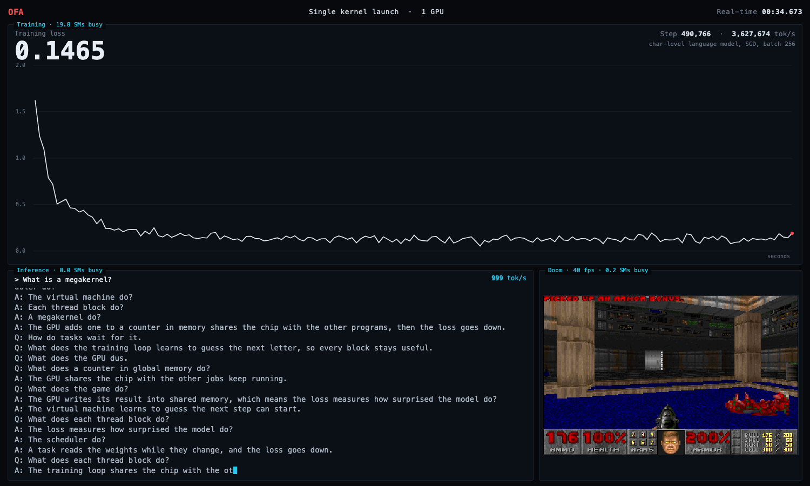
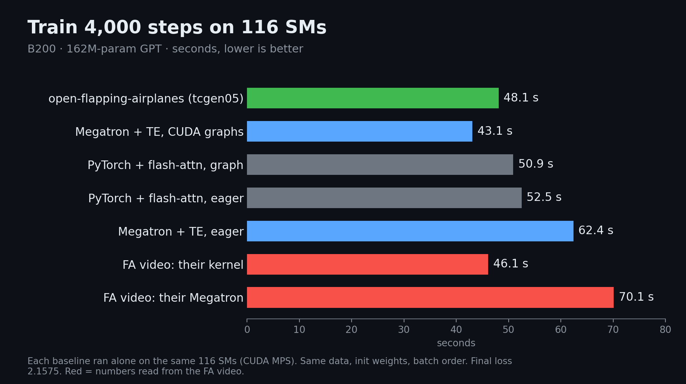
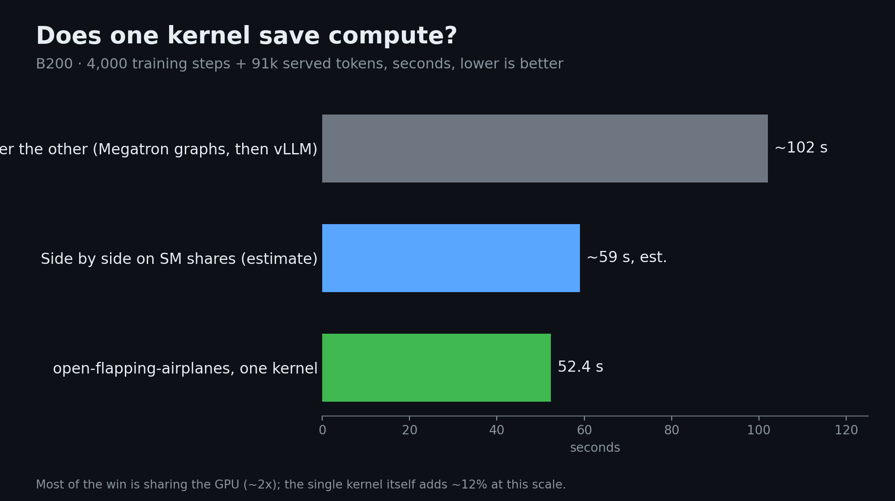
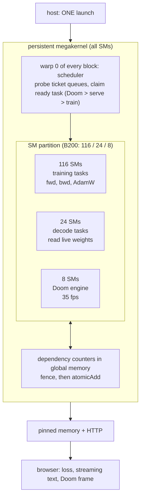
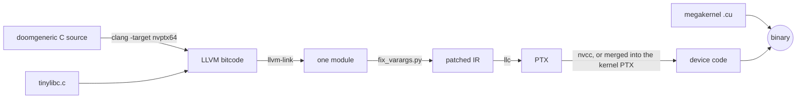

<div align="center">



# open-flapping-airplanes

**One persistent GPU kernel that trains a language model, serves it live, and plays Doom, all at the same time.**

   

[Results](#results) · [Architecture](#architecture) · [Compared with Flapping Airplanes](#how-it-compares-to-flapping-airplanes) · [Quick start](#quick-start) · [Repo map](#repo-map) · [Limitations](#limitations) · [Videos](#videos)

</div>

---

An independent rebuild of the idea in the public demo video of Flapping Airplanes: a "megakernel" in which
training, inference and a game share one GPU through one kernel launch. We have not seen their code. Everything here was written and measured
from scratch, and every number below comes from a result file in this repo.

> Formerly named **open-flapping-airplanes**. The name changed to open-flapping-airplanes; the internal binaries, kernels, folders and result keys keep the
> `ofa_*` prefix (`ofa_fast`, `ofa_tc2`, `ofa_tc3`, `ofa_s`, `llm/ofa_fast/`, ...) because scripts and result files refer to them.

| | Program | What happens |
|---|---|---|
| Train | **Training** | A GPT learns online: forward, backward and AdamW all run as tasks inside the kernel. |
| Serve | **Inference** | Text streams out of the live, still-training weights, so the output improves while the loss falls. |
| Play | **Doom** | The real engine (doomgeneric, shareware E1M1) runs its own game loop on the GPU at 35 fps, played by a scripted player. |

<div align="center">



</div>

## Results

### Headline: LLM scale on one NVIDIA B200 (Modal `gpu="B200"`, 148 SMs)

162.4M-parameter GPT ("S"), 4,000 steps of 4,096 tokens, final loss 2.1575. Split: 116 SMs train, 24 serve, 8 run Doom. Serving uses Flapping
Airplanes' prompt "What is a megakernel?". Baselines run alone on the same SM shares (CUDA MPS). Source: [`b200-run/README.md`](b200-run/README.md).

| System | 4,000 training steps | Serving | Doom |
|---|---|---|---|
| **open-flapping-airplanes, `tcgen05` GEMMs, 3 stages** (`ofa_tc3`) | **48.1 s** | **1,660 tok/s** | 35 fps |
| **open-flapping-airplanes, `tcgen05` GEMMs, 2 stages** (`ofa_tc2`) | **52.4 s** | **1,741 tok/s** | 35 fps |
| open-flapping-airplanes, `mma.sync` GEMMs (`ofa_s`, first build) | 95.8 s | 1,783 tok/s | 35 fps |
| Megatron-core + Transformer Engine, eager, 116 SMs | 62.4 s | - | - |
| **Megatron-core + Transformer Engine, CUDA graphs, 116 SMs** | **43.1 s** | - | - |
| PyTorch + flash attention, one CUDA graph per step, 116 SMs | 50.9 s | - | - |
| vLLM 0.33.0, CUDA graphs, 24 SMs, 16 reserved CPU cores | - | 1,537 tok/s | - |

Megatron + Transformer Engine with CUDA graphs trains faster than both of our builds on this GPU (43.1 s against 48.1 s and 52.4 s). Eager
Megatron is slower than us, and vLLM serves slower than us.

<p align="center">


</p>
<p align="center">

</p>

Red bars are numbers read from Flapping Airplanes' video; everything else was measured here. Charts are generated by [`tools/make_b200_charts.py`](tools/make_b200_charts.py) (run it from `site/assets/`).

### Same GPT on one NVIDIA A100 (108 SMs, 85 / 17 / 6 split)

| System | 4,000 steps | Throughput | Serving | Doom |
|---|---|---|---|---|
| **open-flapping-airplanes, `llm/ofa_fast`** (best A100 build, real Doom on) | **190.7 s** | 85.9k tok/s | 591 tok/s | 35 fps |
| Megatron-core + Transformer Engine, restricted to 84 SMs, alone | 233.2 s | - | - | - |
| PyTorch eager, 84 SMs, alone | 226.2 s | - | - | - |

`ofa_fast` is 1.22x faster than the Megatron + TE baseline and 1.19x faster than eager PyTorch, with the same loss (2.1490) as the Doom-free
build. It merges Doom's PTX into the kernel's PTX so the Doom build avoids the relocatable-code slowdown (224 s with `-rdc`, 190.7 s merged);
see [`llm/ofa_fast/README.md`](llm/ofa_fast/README.md) and [`llm/baseline/README.md`](llm/baseline/README.md).

### Same GPT on an NVIDIA B300 (clearly not a B200)

Modal `gpu="B300"` (SXM6, compute capability 10.3, 148 SMs), Doom compiled out, `tcgen05` megakernel: **49.9 s** for 4,000 steps on the 116 / 24 / 8
split (40.1 s training-only on all SMs), serving about 1,080 tok/s. Baselines there had no Transformer Engine: PyTorch eager on 116 SMs 55.9 s,
Megatron-core without TE 136.6 s. Data: [`llm/b200/results/`](llm/b200/results/README.md), report [`B300_ROUND2.md`](llm/b200/results/B300_ROUND2.md).
**These are B300 measurements, not B200**; the folder name comes from a Modal `B200+` request that can land on either chip.

### The small demo (115k-parameter char model, A100 and B200)

The original demo is a tiny model whose step lasts about 56 microseconds. There, the same task code launched as ordinary per-op kernels is faster
per job (13-25% faster at training); the megakernel's advantage is running all three jobs at once: two processes sharing the GPU are 45-49% slower
on the A100 and 42-58% slower on the B200. Numbers: [`benchmarks/results/`](benchmarks/results/) and the [stats site](site/).

| Demo, all three at once | Train steps/s | Infer tok/s | Doom fps | Launches |
|---|---|---|---|---|
| A100-SXM4-40GB | 13,507.6 | 53,211.6 | 35.0 | 1 |
| B200 | 17,788.6 | 71,349.9 | 35.0 | 1 |

## Architecture

Every block of the kernel is a long-lived worker. Warp 0 of each block polls sharded ticket queues, claims the next ready task (priority Doom,
then inference, then training), and the other warps run it. Tasks signal completion through dependency counters guarded by memory fences, so a
forward pass releases its backward pass and a token releases the next token, with no kernel launch in between.




On Blackwell the GEMMs use `tcgen05` instructions with TMA loads and TMEM accumulators ([`llm/b200/gemm_tcgen05/`](llm/b200/gemm_tcgen05/README.md)),
34-73% of cuBLAS speed on the model's 15 GEMM shapes against 13-33% for the earlier `mma.sync` code.

**How Doom runs on a GPU.** doomgeneric is compiled with clang's NVPTX backend against a small hand-written tinylibc. clang 14 cannot select
`va_start` for NVPTX, so `fix_varargs.py` lowers varargs at the LLVM IR level; `build_doom.sh` patches static initialisers PTX cannot express, and
sound is disabled. Thread 0 runs the game logic and queues column and span draws; the other 255 threads of the block execute the queue behind a
named barrier, which takes a frame from 24 ms to 6.7 ms with a pixel-identical picture.



## How it compares to Flapping Airplanes

Their column is read frame by frame from their demo video ([`benchmarks/fa_published.json`](benchmarks/fa_published.json)); we did not measure it.
Ours is the B200 run above (same chip, same 116 / 24 / 8 split, Megatron + Transformer Engine and vLLM as baselines, a 162M-parameter GPT; their
model size, data and settings are unpublished). "Slower" is FA's metric, 1 - baseline rate / megakernel rate.

| | Flapping Airplanes (B200, video) | Ours, `tcgen05` 3 stages (`ofa_tc3`) | Ours, `tcgen05` 2 stages (`ofa_tc2`) |
|---|---|---|---|
| 4,000 steps, megakernel | 46.1 s | 48.1 s | 52.4 s |
| Serving "What is a megakernel?" | 1,076 tok/s | 1,660 tok/s | 1,741 tok/s |
| vs Megatron + TE, eager | 70.1 s: baseline **34% slower** | 62.4 s: baseline **23% slower** | 62.4 s: baseline **16% slower** |
| vs Megatron + TE, CUDA graphs | not reported | 43.1 s: baseline **11.5% faster** | 43.1 s: baseline **21.5% faster** |
| vs vLLM serving | 710 tok/s: baseline **34% slower** | 1,537 tok/s: baseline **7% slower** | 1,537 tok/s: baseline **12% slower** |
| Kernel launches | 1 vs 514,562 | 1 vs 2.2M-4.2M host launch calls (15.2M kernels) | same |
| Doom | plays throughout | 35 fps throughout | 35 fps throughout |

- **Launches.** For the same work (4,000 steps plus about 91,000 served tokens) the baselines make 1.2M to 8.4M launches depending on how they are
  counted (graph launches versus every kernel). Nsight Systems counts **3** launches for a whole `ofa_tc2` process: two one-off setup kernels
  and the megakernel, which runs all training, serving and Doom ([`b200-run/results/launches_ofa_tc2/`](b200-run/results/launches_ofa_tc2/nsys_launches.json)).
- **Training.** We beat Megatron + TE as frameworks run by default (eager), by 16-23% against their 34%. Megatron + TE with CUDA graphs is faster than
  we are: 43.1 s against 48.1 s and 52.4 s. We do not know whether their baseline used graphs.
- **Serving.** vLLM at batch 1 is bound by its CPU. With 16 reserved cores it made 1,537 tok/s; in a container without them 684 tok/s, close to FA's 710.
  We compare against the faster figure, which favours the baseline.
- **Doing all three at once saves time, mostly because the GPU is shared.** Same work, one B200: sequential Megatron (graphs) then vLLM about 102 s;
  the two side by side on their SM shares about 59 s (estimated from separate runs); one megakernel 52.4 s (measured).

More rows (PyTorch, no-TE Megatron, the A100 and B300 runs, the toy demo) are in [`docs/FA_COMPARISON.md`](docs/FA_COMPARISON.md).

## Quick start

You need either an NVIDIA A100 box reachable over SSH, or a [Modal](https://modal.com) account for a B200. The shareware `doom1.wad` is not in this
repo; the setup scripts download it and keep it only if its md5 matches.

**A100 (SSH box):**

```bash
./doom-gpu/setup_box.sh ubuntu@<ip>              # once: clang, doomgeneric, shareware WAD (md5 checked)
./a100-demo/run_demo.sh ubuntu@<ip>              # the small demo, tunnelled to http://localhost:8080
MODEL=S ./llm/ofa_fast/run_ofa.sh ubuntu@<ip> 8080   # the 162M GPT: train + serve + Doom, one launch
./benchmarks/run_benchmarks.sh ubuntu@<ip> 5 6   # small-demo benchmark, writes benchmarks/results/
python3 -m http.server 8000 --directory site     # the stats site, http://localhost:8000
```

**B200 (Modal, no SSH):**

```bash
uv tool install modal && modal setup             # once
modal run b200-run/modal_app.py --step <prep|env|mk|tccmp|train|serve|gemm|report>    # LLM-scale comparison, see b200-run/README.md
modal run benchmarks/run_modal.py --mode bench   # the small demo on one B200 (about 7 GPU-minutes)
```

Modal runs cost money (a B200 is billed per second); read `b200-run/README.md` before running the full comparison.

## Repo map

| Path | What |
|---|---|
| `b200-run/` | The LLM-scale comparison on a real B200 against Megatron + TE and vLLM: `modal_app.py`, `results/` |
| `llm/` | LLM megakernel work: `ofa_fast/` (best A100 build), `ofa/` (rdc Doom build), `megakernel/` (Doom-free), `gemm/`, `gemm2/`, `attention/`, `decode/`, `baseline/` (Megatron, PyTorch, vLLM on A100), `b200/` (Blackwell kit: `tcgen05` GEMMs, megakernel, Modal drivers) |
| `llm/b200/results/` | **B300** measurements (not B200), with a README saying so |
| `a100-demo/` | The small-model demo: `demo.cu` megakernel with an HTTP server, three-panel dashboard |
| `doom-gpu/` | Compiling Doom for the GPU: tinylibc, `fix_varargs.py`, `build_doom.sh`, `setup_box.sh`; `player/` is the scripted player |
| `benchmarks/` | Small-demo benchmarks: `run_benchmarks.sh` (SSH), `run_modal.py` (Modal), `compare.py`, `fa_published.json`, `results/` |
| `site/` | Static stats website (`index.html`, `data/`, `assets/`) |
| `video/` | Sources of the explainer video and of the B200 demo video |
| `tools/` | `gen_svgs.py` regenerates the animated SVGs |
| `docs/` | `FA_COMPARISON.md` (every run next to FA's numbers), `RESEARCH.md` (research log), `REORG_PLAN.md` (a folder regrouping that is not done) |

## Limitations

- **Not their code or model.** Same chip, SM split and baselines as the Flapping Airplanes video, but their model, data and training settings are unpublished. We do not reproduce their 46.1 s (our fastest is 48.1 s) or their trained answers (ours is trained on TinyStories).
- **Megatron + TE with CUDA graphs still trains faster than us on the B200** (43.1 s against 48.1 s).
- **"1 launch" counts the run, not setup.** Nsight Systems shows 3 launches, 2 of them one-off setup kernels. The baselines' counts leave out setup too.
- **B300 data is not B200 data.** `llm/b200/results/` was measured on a B300; the B200 results are in `b200-run/`.

## Videos

- [B200 demo in Flapping Airplanes' format (74.6 s)](video/release/ofa_demo_b200.mp4): a recorded run of the LLM-scale megakernel, the split, the code,
  the side by side with the baselines, and the result cards. Every number comes from `b200-run/results/` through `video/b200/make_data.py`.
- [Explainer (86 s)](video/release/ofa_explainer_preview.mp4): older preview whose B300 numbers are interim; it will be re-rendered.

Both play when opened from the repo on GitHub. Sources are in [`video/`](video/README.md).

## Credits and licensing

- Independent rebuild, **not affiliated with, endorsed by, or based on code from Flapping Airplanes**. Their numbers come from their public video.
- **doomgeneric** by ozkl is GPL-licensed; `setup_box.sh` clones it and it is not stored in this repo. **Doom** is by id Software.
- The **shareware `doom1.wad` is not included**; the setup script downloads it and checks its md5.
- This repo has no license file yet; the owner has not chosen one.
- Background: [`docs/RESEARCH.md`](docs/RESEARCH.md), [`benchmarks/README.md`](benchmarks/README.md), [`site/README.md`](site/README.md).
